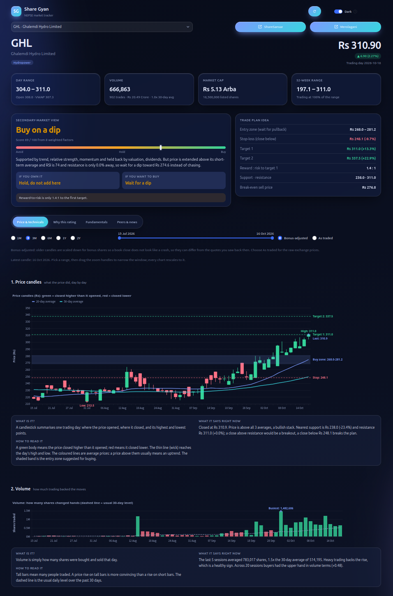
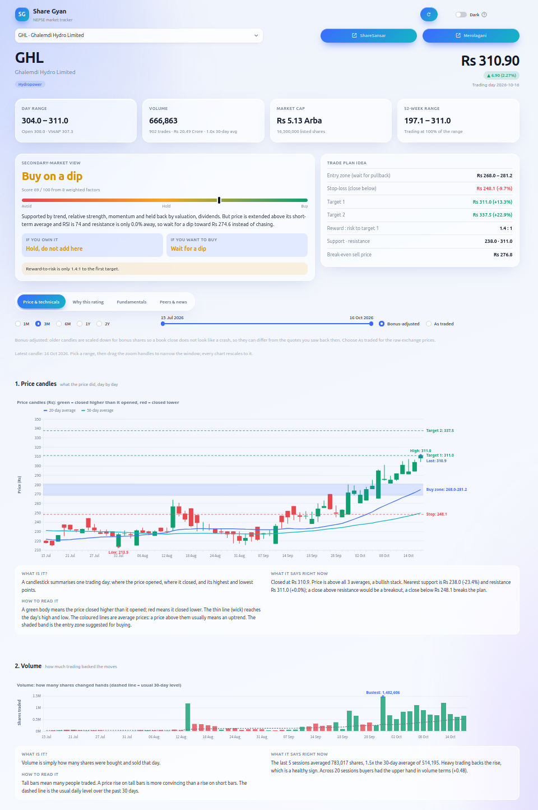

 #   Share Gyan (शेयर ज्ञान)

A free, open-source Streamlit dashboard for **Nepal's share market (NEPSE)** where you can get the daily market stock information.. It puts everything a Nepali investor checks every day in one place: index levels and sector moves, the full price board, IPO and right-share issues with MeroShare results, dividends, AGMs and news.


## Setup

* prerequisite:

> Install [uv](https://docs.astral.sh/uv/):

* Create and activate venv

```bash
uv venv
source .venv/bin/activate
```

* Install Dependencies

```bash
uv sync
```

## Run

```bash
uv run app
```

This starts the Streamlit server and opens the app in your browser.

## Data

Everything is scraped live (cached for 5 minutes; the refresh button in the header re-scrapes):

* `ShareSansar`: indices, sub-indices, full price board, company names and links, all issue types (IPO, Right, FPO, Mutual fund, Debenture), SEBON pipeline, dividends, mergers, news
* `Merolagani`: NEPSE and per-scrip price history, company fundamentals (EPS, P/E, book value, dividends), AGM and right-share calendar, news

Every symbol in the app links to the in-app Stock Analysis page (`/stock?symbol=GHL`); see [Stock Analysis](#stock-analysis) below.

Share Gyan Nepal renders client-side through a private, header-gated API, so it is linked but not scraped.

The light/dark switch in the header is stored in the URL (`?theme=dark`).

## Stock Analysis

Click any symbol in a table or card, or pick one on the **Stock Analysis** page (next to Market Trends), to open a full read on that scrip without leaving the site. It is built for the secondary market (buying and selling listed shares) and is written to be readable by a beginner.

* **Header and snapshot**: price and day change, day range with open and VWAP, volume against its 30-day average, market cap and 52-week range.
* **Secondary-market view**: a rating with a 0 to 100 score, a one-line reason, and a separate action for **people who already own it** and **people thinking of buying**. Warnings flag thin liquidity, downtrends, overbought RSI and nearby book closes or AGMs.
* **Trade plan idea**: a buy zone, stop-loss, two targets, reward-to-risk and the break-even sell price after charges. When the rating is Reduce or Avoid it switches to **Levels to watch** instead, because no entry is suggested.
* **Price & technicals**: choose a range (3 months by default) and the chart style. **Interactive** (the default) is a TradingView-style chart built on the open-source [Lightweight Charts](https://github.com/tradingview/lightweight-charts) library (Apache-2.0, bundled in `src/share_gyan/assets/`): scroll to zoom, drag to pan, hover for a crosshair with open, high, low, close, change and volume, and the price, RSI and MACD charts move together. **Classic** is a static chart with a zoom slider. You can also switch between bonus-adjusted and as-traded prices. Each chart has a short *What is it / How to read it / What it says right now* note:
  1. **Price candles and volume** with 20, 50 and 200-day averages, the buy zone, stop and targets drawn as labelled price lines, and the period high and low marked.
  2. **RSI**, a 0 to 100 gauge of how overheated or washed-out the price is.
  3. **MACD**, which shows whether buying or selling momentum is building.

  Below them are period returns, a comparison with NEPSE, an indicator table, the **key insights**, a **conclusion** with what to do and what would change the view, an optional check against your own average buy price, and a **buy and sell plan for your capital** (shares per step, when to sell, and the net result after charges and tax).
* **Why this rating**: the factors behind the score (trend, momentum, volume, 52-week position, strength against NEPSE, valuation, dividends, risk and liquidity) with their weights.
* **Fundamentals**: EPS, P/E, book value, P/B, dividends and cash dividend history.
* **Peers & news**: the most traded scrips in the same sector with their P/E and P/B, and headlines that mention the symbol.
* **Shares to buy today**: at the bottom of the page, **Scan the market** rates the most traded scrips and lists the strongest buy setups ranked by profit potential.

| Rating | Meaning |
| --- | --- |
| Buy | Signals line up and the price is not stretched: buy in stages. |
| Accumulate | Leaning positive: add gradually near the buy zone. |
| Buy on a dip | Good setup but the price is stretched (high RSI, far above its average or just under resistance): wait for a dip. |
| Hold / Wait | No clear edge: holders sit tight, new buyers wait. |
| Reduce | Evidence is negative: trim into strength, do not add. |
| Avoid | Trend and momentum are weak: stay out, or exit if you hold. |

The rating comes from a fixed rule-based scoring of public price and ratio data (no language model), so the same data always gives the same answer. It cannot see company news or your situation. It is a screening aid, not investment advice.

## IPO results from your MeroShare account

The MeroShare page signs in to your account and shows your details, portfolio and ASBA applications with allotment results (also summarised on IPO Results), and lets you apply for open IPOs from the Apply IPO tab. Either fill in the sign-in form (kept in memory for the browser session only) or use a `.env` file:

```bash
cp .env.example .env   # then fill in MEROSHARE_DP, MEROSHARE_USERNAME, MEROSHARE_PASSWORD (and MEROSHARE_CRN to apply for IPOs)
```

* `.env` is git-ignored. Restart the app after editing it.
* The login goes only to `webbackend.cdsc.com.np`, is never logged or displayed, and nothing is stored on disk.
* The server is bound to `127.0.0.1` (see `.streamlit/config.toml`) because the page shows private account data. Do not expose it publicly.

## WhatsApp alerts for open IPOs and debentures

`notify-ipo` checks ShareSansar and sends a WhatsApp message through [Twilio](https://www.twilio.com/whatsapp) when a new IPO or debenture opens. Each issue is announced once (tracked in `.notify_state.json`).

1. In the Twilio Console, open the WhatsApp sandbox and join it by sending `join <your-code>` from your phone to the sandbox number. Re-join if the session expires.
2. Set `TWILIO_ACCOUNT_SID`, `TWILIO_AUTH_TOKEN` and `WHATSAPP_PHONE` (international format, no `+`; separate several numbers with commas, each must join the sandbox) in `.env`. `TWILIO_WHATSAPP_FROM` defaults to the sandbox number.
3. Test it, then schedule it:

```bash
uv sync
uv run notify-ipo --test      # sends a test message
uv run notify-ipo --dry-run   # prints what would be sent
crontab -e                    # e.g. every 30 minutes:
# */30 * * * * cd /path/to/share-gyan && uv run notify-ipo >> notify.log 2>&1
```

## Screenshots

> ### Dashboard

<table>
  <tr>
    <td align="center"><b>Dark</b><br></td>
    <td align="center"><b>Light</b><br></td>
  </tr>
</table>

> ### Market Trend

<table>
  <tr>
    <td align="center"><b>Dark</b><br></td>
    <td align="center"><b>Light</b><br></td>
  </tr>
</table>

> ### Stock Analysis

<table>
  <tr>
    <td align="center"><b>Dark</b><br></td>
    <td align="center"><b>Light</b><br></td>
  </tr>
</table>

> ### IPO Info

<table>
  <tr>
    <td align="center"><b>Dark</b><br></td>
    <td align="center"><b>Light</b><br></td>
  </tr>
</table>

> ### IPO Results

<table>
  <tr>
    <td align="center"><b>Dark</b><br></td>
    <td align="center"><b>Light</b><br></td>
  </tr>
</table>

> ### MeroShare

<table>
  <tr>
    <td align="center"><b>Dark</b><br></td>
    <td align="center"><b>Light</b><br></td>
  </tr>
</table>

> ### News Hub

<table>
  <tr>
    <td align="center"><b>Dark</b><br></td>
    <td align="center"><b>Light</b><br></td>
  </tr>
</table>

> ### Corporate Actions

<table>
  <tr>
    <td align="center"><b>Dark</b><br></td>
    <td align="center"><b>Light</b><br></td>
  </tr>
</table>

> ### Tools

<table>
  <tr>
    <td align="center"><b>Dark</b><br></td>
    <td align="center"><b>Light</b><br></td>
  </tr>
</table>
